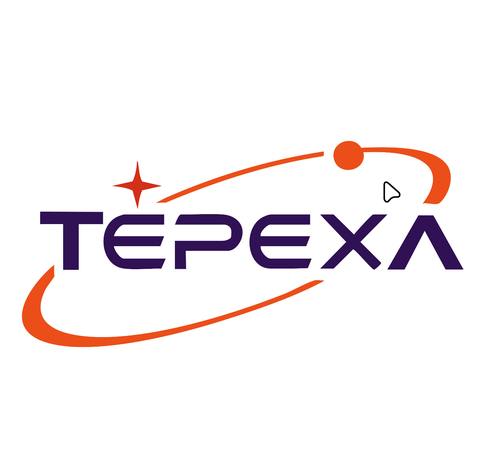

<p align="center">
  
</p>

<h1 align="center">TEPEXA — Explore the Unknown</h1>

<p align="center">
  <b>Explora el cráter Jezero con datos reales de NASA, planifica una caminata (EVA) entre las rocas que muestreó
  Perseverance y simúlala en 3D.</b>
</p>

<p align="center">
  <a href="https://tepexa-ruby.vercel.app"></a>
  <a href="https://tepexa-api.onrender.com/docs"></a>
  
</p>

Proyecto para el reto **Interplanetary Survival Guide: Martian Map** de NASA Space Apps Challenge 2026.
Un **estudiante** explora las capas científicas de la Margin Unit del cráter Jezero; un **astronauta** elige
objetivos, compara tres rutas calculadas sobre un modelo de elevación real y camina la elegida en 3D.

> Planificación conceptual y educativa. No es un sistema certificado para operaciones reales.

**👉 Pruébala:** [tepexa-ruby.vercel.app](https://tepexa-ruby.vercel.app). La API duerme si nadie la usa; la
primera carga puede tardar ~50 s y la app lo avisa.

---

## Qué hace

| Módulo | Qué ves | De dónde salen los datos |
|---|---|---|
| **Martian Atlas** | Mapa 2D de la Margin Unit con relieve, elevación y los sitios de muestra de Perseverance. Medusae Fossae como segunda región | DTM HiRISE (USGS) y catálogo de la API, cada dato con su fuente y su certeza |
| **Planificador de rutas** | Base y objetivos en orden, pendiente máxima y tiempo de EVA; las rutas **más corta, más rápida y más segura** con su perfil de elevación | `POST /routes/compare`: Dijkstra sobre una rejilla de 10 m del DTM real |
| **Análisis de misión** | Comparación de rutas, geología de cada objetivo, fuentes e informe imprimible | `POST /missions` y `/missions/{id}/report` |
| **Simulación 3D** | El tripulante camina la ruta con casco, acompañado del dron; cámaras en 1.ª y 3.ª persona, telemetría y minimapa | Terreno 3D del mismo DTM y la misma polilínea de la API |
| **Tripulación** | Los avatares 3D del equipo caminando, con o sin casco, y el dron de reconocimiento | Modelos del equipo optimizados (`frontend/public/models/`) |
| **Asistente** | Respuestas a preguntas sobre la misión | Sin IA generativa: se arman con los datos reales de la API |

Funciona en PC y en celular, en español e inglés (según el navegador).

## Datos reales y lo que no lo es

- **Elevación:** DTM HiRISE de 1 m de la Margin Unit (recorte de 4 × 3 km). NASA/JPL-Caltech/University of
  Arizona; USGS Astrogeology — Fergason et al. (2020), [doi:10.5066/P9REJ9JN](https://doi.org/10.5066/P9REJ9JN).
- **Puntos de interés:** sitios de muestreo de Perseverance (NASA/JPL-Caltech).
- **Hechos científicos:** cada uno cita misión, instrumento y artículo, y dice si es *confirmado*,
  *interpretación* o *hipótesis*.
- **Marcados como no-NASA:** los modelos artísticos del equipo (cráter, Medusae, Marte), el traje del avatar y el
  **terreno ilustrativo de Medusae Fossae** del simulador (la API aún no tiene un DTM de esa zona). Todo lo
  ilustrativo lleva su etiqueta en pantalla y `is_example: true` en los datos.

## Arquitectura

```
tepexa/
├── frontend/      # React 18 + TypeScript + Vite · OpenLayers (2D) · React Three Fiber (3D)
├── backend/       # API en Python + FastAPI · motor de rutas · misiones e informe
├── contracts/     # Contrato backend ↔ frontend: openapi.json y ejemplos
├── pipeline/      # Datos de Jezero (DTM, catálogo) y optimizador de modelos 3D
├── specs/         # Una carpeta por spec de SDD: spec, clarificación, plan y tareas
└── docs/          # Constitución, estado y decisiones, traspaso al frontend, método SDD
```

| Pieza | Servicio |
|---|---|
| App web | Vercel — [tepexa-ruby.vercel.app](https://tepexa-ruby.vercel.app) |
| API | Render — `https://tepexa-api.onrender.com/api/v1` |
| Base de datos | Neon (PostgreSQL + PostGIS) |

Coordenadas en un marco local en metros por región: el mapa, el 3D, las rutas y el informe usan la misma
polilínea que entrega la API. Nadie recalcula rutas en el navegador.

## Correrlo en local

**Frontend** (Node 20+):
```bash
cd frontend
npm install
npm run dev            # http://localhost:5173 · usa la API publicada por defecto
```

**Backend** (Python 3.12 o más nuevo):
```bash
pip install -r backend/requirements-dev.txt
pytest -q backend/tests
uvicorn app.main:app --reload --app-dir backend   # http://localhost:8000/docs
```
Sin base de datos, la API sirve los ejemplos del contrato (`TEPEXA_MODE=example`). Con `TEPEXA_MODE=live` y
`DATABASE_URL` en `.env.local` lee los datos reales. Más detalle en [`frontend/README.md`](frontend/README.md)
y [`docs/HANDOFF-FRONTEND.md`](docs/HANDOFF-FRONTEND.md).

## Cómo lo construimos: Spec-Driven Development

Partimos de la plantilla de [mouredev/hello-sdd](https://github.com/mouredev/hello-sdd) y la adaptamos al
proyecto en [`docs/METODO-SDD.md`](docs/METODO-SDD.md). Cada pieza tiene su spec antes que su código:

| Spec | Qué resuelve |
|---|---|
| 000 · Contrato de la API | Lo que backend y frontend acordaron intercambiar |
| 001 · Base de datos y catálogo | Neon + PostGIS, catálogo con fuentes, publicación en Render |
| 002 · Pipeline de datos | DTM HiRISE real y sitios de Perseverance |
| 003 · Motor de rutas | Tres perfiles con regreso a la base y límites de seguridad |
| 004 · Misiones e informe | Guardar la misión y generar el informe |
| 005 · Terreno 3D | El terreno real servido para el simulador |
| 006 · Assets 3D | Optimizador de modelos y revisión automática de cada PR |

**El flujo en una línea:** Constitución → Spec → Clarificación → Plan → Tareas → Implementación (pruebas
primero) → Validación → Cambio (primero la spec, luego el código).

Antes de pedirle algo a un agente de código, lee [`AGENTS.md`](AGENTS.md).

## Equipo

| Integrante | Rol |
|---|---|
| **Dirk Donley Martinez Lackut** | Desarrollador backend y QA |
| **Dylan Hernán Ruiz Romero** | Desarrollador |
| **Israel de Jesús Espinoza Franco** | Líder del equipo, comunicador, desarrollador frontend y UX/UI |
| **Jasury del Socorro Orozco Reyes** | Frontend y UX/UI |
| **Luis Alejandro Castañeda Díaz** | Viabilidad técnica y redacción |
| **Silvio Yasid Gaitan Arguello** | Viabilidad técnica y redacción |

Hecho en Managua, Nicaragua, para NASA Space Apps Challenge 2026.

<sub>Datos: NASA/JPL-Caltech, USGS Astrogeology, University of Arizona. TEPEXA no está afiliado a NASA ni
la representa.</sub>
